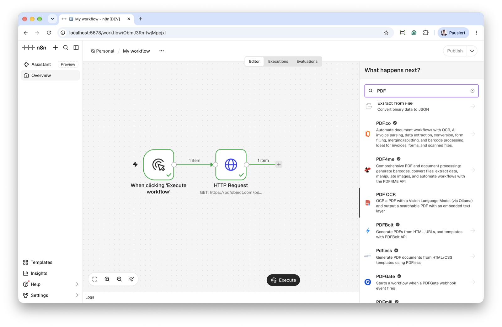
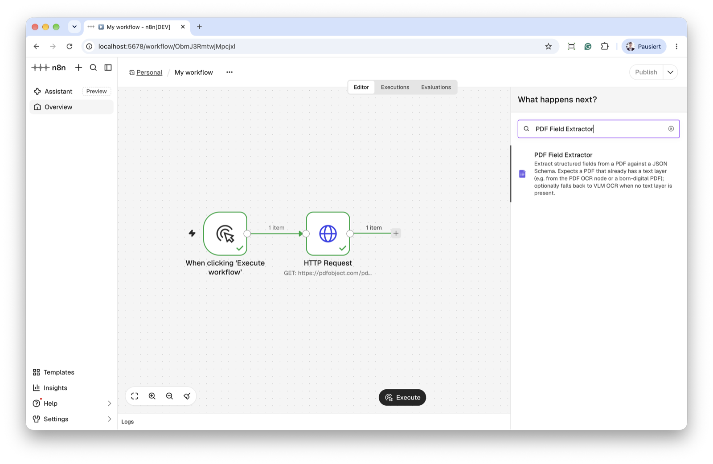
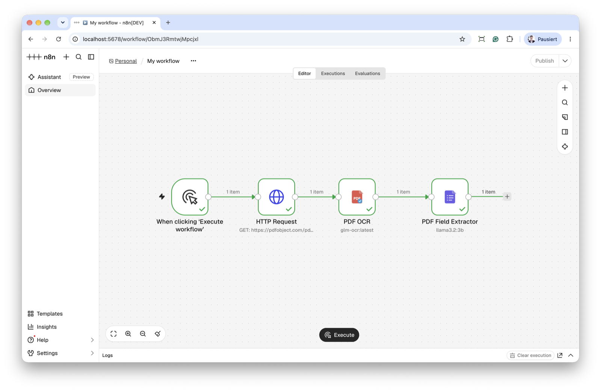
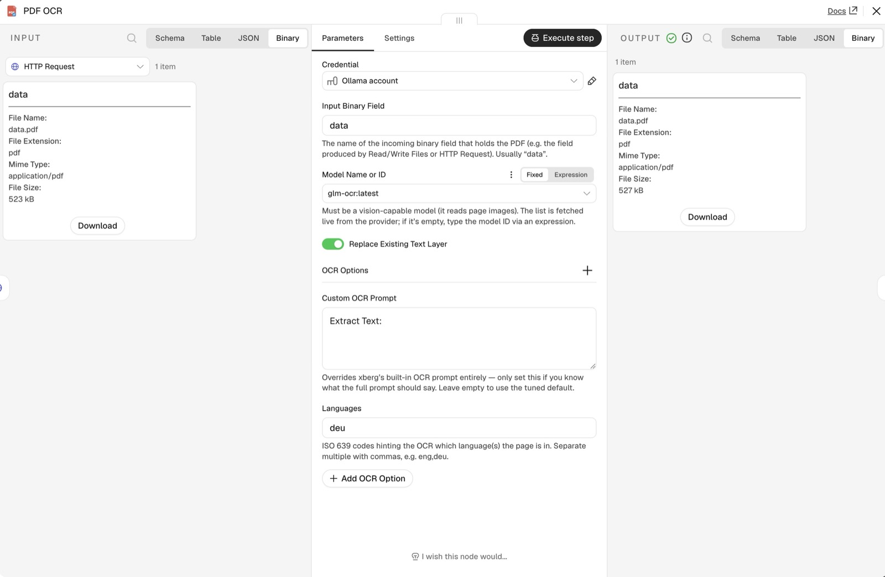
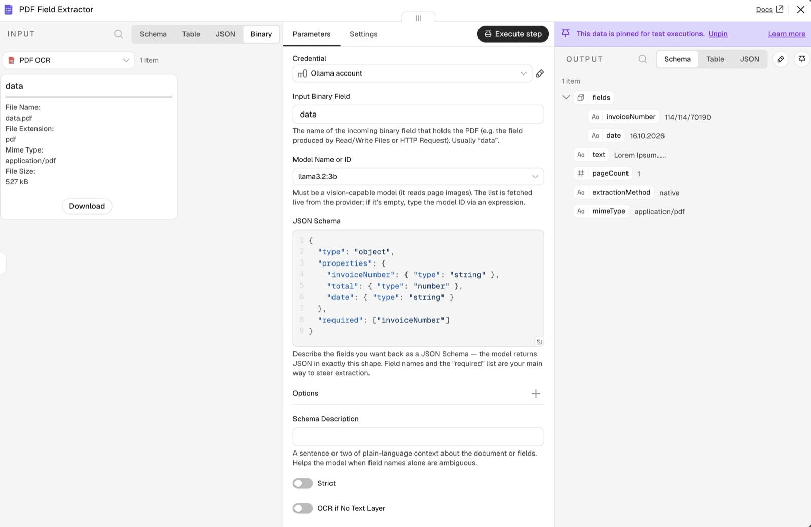

# n8n-nodes-xberg-pdf-vlm-extractor

[](https://www.npmjs.com/package/n8n-nodes-xberg-pdf-vlm-extractor)
[](https://github.com/michaelwittmann/n8n-nodes-xberg-pdf-vlm-extractor/actions/workflows/ci.yml)
[](LICENSE)
[](#prerequisites)

Two [n8n](https://n8n.io) community nodes that use a **Vision Language Model (VLM)** to work with PDFs, powered by the [`@xberg-io/xberg`](https://www.npmjs.com/package/@xberg-io/xberg) document-extraction library:

- **PDF OCR** — runs VLM-based OCR on a PDF and returns a **searchable PDF** with the recognised text embedded as an invisible layer.
- **PDF Field Extractor** — extracts structured fields from a PDF against a JSON Schema you provide, using the PDF's embedded text layer (with an optional VLM-OCR fallback).

Both nodes let you pick an LLM **provider** — **Ollama** (local), **OpenAI**, **Anthropic**, or **Google Gemini** — authenticate with n8n's matching built-in credential, and choose the model from a dropdown populated live from that provider.

> **Self-hosted only.** This package has a runtime dependency (`@xberg-io/xberg` ships platform-specific native binaries), so it is **not eligible for n8n Cloud verification**. It installs and runs on self-hosted n8n.

Both nodes show up in the n8n **nodes panel** — search "PDF":

| PDF OCR | PDF Field Extractor |
| --- | --- |
|  |  |

## How the two nodes fit together

```
PDF source ──▶ PDF OCR ──▶ PDF Field Extractor ──▶ …
(disk / HTTP)  (searchable PDF)   (structured JSON)
```

- **Scanned / image-only PDF?** Run **PDF OCR** first. Its output is a searchable PDF, so any downstream node — including **PDF Field Extractor** — can read the text without OCR'ing again.
- **Born-digital PDF (already has a text layer)?** Send it straight into **PDF Field Extractor**; it reads the embedded text layer directly.
- **No text layer and you'd rather not chain two nodes?** Turn on **OCR if No Text Layer** in the Field Extractor to let it OCR the PDF itself.

The two steps are fully independent — use either on its own.

## Quick start

1. **Install** the package in your self-hosted n8n (see [Installation](#installation)).
2. **Import the example workflow:** in n8n, open a new workflow → **⋯ menu → Import from File** and pick [`docs/example-workflow.json`](docs/example-workflow.json) (or copy its contents and paste onto the canvas). It wires up **Manual Trigger → HTTP Request → PDF OCR → PDF Field Extractor** — the **HTTP Request** node fetches a sample PDF, so it runs with no file on the n8n host. (Swap in **Read/Write Files from Disk** if you'd rather read a local PDF.)
3. **Create an Ollama credential** (**Settings → Credentials → New → Ollama**, Base URL `http://localhost:11434`) and select it on both nodes. Swap in OpenAI/Anthropic/Gemini if you prefer — see [Providers & credentials](#providers--credentials).
4. Pick a **vision-capable model** from the dropdown on each node and run.



## Installation

Follow the [n8n community nodes installation guide](https://docs.n8n.io/integrations/community-nodes/installation-and-management/).

In your self-hosted n8n: **Settings → Community Nodes → Install**, then enter:

```
n8n-nodes-xberg-pdf-vlm-extractor
```

Or install from the command line in your n8n custom-nodes directory:

```bash
npm install n8n-nodes-xberg-pdf-vlm-extractor
```

## Prerequisites

- **Node.js >= 24** (matches current n8n; `@xberg-io/xberg` needs >= 22, but this package targets the n8n runtime).
- An LLM provider with a **vision-capable model**, and the matching n8n credential (see below). For a local setup, a running **Ollama** server with a vision model pulled:

  ```bash
  ollama pull glm-ocr              # OCR; or qwen3-vl / deepseek-ocr
  ollama pull qwen3-vl:8b-instruct # field extraction (needs structured-output support)
  curl http://localhost:11434/api/tags   # confirm the models are listed
  ```

## Providers & credentials

Pick the **Provider** on the node, then attach the matching credential. All four are **built-in** n8n credentials (shipped by n8n core / the LangChain nodes) — **this package ships none of its own**. xberg routes to each provider natively via [liter-llm](https://github.com/xberg-io/liter-llm); no OpenAI-compatibility shim is needed.

| Provider | n8n credential | Endpoint field | Default |
| --- | --- | --- | --- |
| **Ollama** (local) | `Ollama` (`ollamaApi`) | Base URL (no `/v1` — appended internally) | `http://localhost:11434` |
| **OpenAI** | `OpenAI` (`openAiApi`) | Base URL | `https://api.openai.com/v1` |
| **Anthropic** | `Anthropic` (`anthropicApi`) | Base URL | `https://api.anthropic.com` |
| **Google Gemini** | `Google Gemini(PaLM) Api` (`googlePalmApi`) | Host | `https://generativelanguage.googleapis.com` |

The **Model** dropdown is populated live from the selected provider (Ollama's `/api/tags`, OpenAI/Anthropic `/models`, Gemini's `/v1beta/models`). If the endpoint is unreachable at edit time, you can still type a model ID via an [expression](https://docs.n8n.io/code/expressions/).

### Verified models

Models vary a lot in how well they handle OCR and schema-constrained extraction. These are the ones that worked well in testing (local Ollama tags shown); the **preferred** pick in each category is marked. Any vision-capable model your provider offers will appear in the dropdown — this is a starting point, not an allow-list.

| Node | Verified models | Notes |
| --- | --- | --- |
| **PDF OCR** | `glm-ocr` ✅ *(best in testing)*, `qwen3-vl`, `deepseek-ocr` | OCR-tuned vision models. `glm-ocr` gave the most accurate transcription. |
| **PDF Field Extractor** | `qwen3-vl:8b-instruct` ✅ *(preferred)*, `llama3.2:3b` | Must support **structured output** (JSON-schema-constrained generation). See the note below. |

> **Field extraction needs structured-output support.** The Field Extractor always asks the model for JSON constrained to your schema (via the provider's structured-output / grammar mode). Models that don't support it — e.g. some `gemma3` tags on Ollama — fail with *"structured output is unavailable"* and return empty fields. If that happens, switch to a model from the table above or upgrade Ollama. Turning off **Strict** does not help: the constraint is inherent to how extraction works.


> **Local Ollama in a container?** If n8n runs in a container and Ollama runs on the host, use `http://host.docker.internal:11434` (or `host.containers.internal` for Podman) as the Base URL.
>
> **API-key note.** For Ollama the API Key is only needed behind an authenticating proxy; leave it empty for a default local install.

## Nodes

### PDF OCR

Runs VLM OCR on every page of the incoming PDF and returns a **searchable PDF**.



1. Feed a PDF into the node as binary data (e.g. from **Read/Write Files from Disk** or **HTTP Request**). The default binary field name is `data`.
2. Pick the **Provider** and **Model** from the dropdowns (the model list is loaded from the selected provider).
3. **Replace Existing Text Layer** (default **on**): removes any text already embedded in the PDF before adding the OCR layer, so a PDF that already carries a (possibly wrong) text layer doesn't end up with two overlapping layers. Turn it off to keep the original text and append the OCR layer on top.
4. Output:
   - **Binary**: a PDF (same field name as the input) with the OCR text embedded as an invisible, selectable text layer — findable with Ctrl+F in any viewer and by downstream text extraction.
   - **JSON**:

     ```json
     {
       "text": "…full transcribed text…",
       "pageCount": 3,
       "mimeType": "application/pdf",
       "searchable": true
     }
     ```

**About the text layer.** xberg's VLM OCR returns text per page but no per-word coordinates, so the embedded layer is flowed in reading order rather than positioned over each original glyph. Full-text search lands on the correct **page**; it does not highlight the exact word position. If a PDF can't be rebuilt (e.g. encryption), the node returns the original PDF plus the text in JSON and sets `searchable: false` with a `warning`. If a single page's existing content can't be safely rewritten, that page falls back to append-only and the rest of the document is unaffected.

### PDF Field Extractor

Extracts structured fields described by a JSON Schema. It expects a PDF that **already has a text layer** (e.g. the output of **PDF OCR**, or a born-digital PDF).



1. Provide the PDF binary as above.
2. Pick the **Provider** and **Model**.
3. In **JSON Schema**, describe the fields you want:

   ```json
   {
     "type": "object",
     "properties": {
       "invoiceNumber": { "type": "string" },
       "total": { "type": "number" },
       "date": { "type": "string" }
     },
     "required": ["invoiceNumber"]
   }
   ```

4. Output:

   ```json
   {
     "fields": { "invoiceNumber": "INV-042", "total": 199.9, "date": "2026-10-27" },
     "text": "…",
     "pageCount": 3,
     "extractionMethod": "native",
     "mimeType": "application/pdf"
   }
   ```

   `extractionMethod` tells you how the text was obtained: `native` (used an embedded layer), `ocr` (fresh VLM OCR), or `mixed`.

   By default (**OCR if No Text Layer** off) the node reads the embedded text layer and **errors if the PDF has none** — run **PDF OCR** first in that case. Turn **OCR if No Text Layer** on to let the node OCR the PDF itself when no layer is present; this reveals the OCR tuning options, including **Force OCR** to always run a fresh pass.

### Options

**PDF OCR:** Replace Existing Text Layer (top-level, default on), plus **OCR Options** — Languages (comma-separated ISO codes, e.g. `eng,deu`), Custom OCR Prompt, Temperature, Timeout (seconds).

**PDF Field Extractor:** an **Options** collection for extraction — Schema Description and Strict mode. The **OCR if No Text Layer** toggle (default off) controls the OCR fallback; when on, an **OCR Options** collection appears (Force OCR, Languages, Custom OCR Prompt, Temperature, Timeout).

Shape extraction through the **JSON Schema** and **Schema Description**, not a custom prompt: xberg's extraction prompt would *replace* its tuned default outright (there's no extend/append hook), so no custom-prompt field is exposed for field extraction.

> **Tip:** OCR-tuned models (e.g. `glm-ocr`, `deepseek-ocr`) are great at transcription but may extract fields less reliably. For field extraction, use a model that supports structured output — `qwen3-vl:8b-instruct` or `llama3.2:3b` worked best in testing (see [Verified models](#verified-models)). `Strict` defaults to off; add a **Schema Description** to steer the model when results are off.

## Local development

```bash
npm install
npm run build        # compile TypeScript to dist/
npm run lint         # lint
npm test             # run the vitest suite
npm run dev          # start a local n8n with the nodes hot-reloaded (http://localhost:5678)
```

`npm run dev` ([docs](https://docs.n8n.io/integrations/creating-nodes/test/run-node-locally/)) is the local test environment — no separate n8n instance is required. To run against an existing host n8n instead:

```bash
N8N_DEV_RELOAD=true npx n8n start
n8n-node dev --external-n8n --custom-user-folder <path>
```

### Tests

The [vitest](https://vitest.dev) suite covers the shared provider/OCR config helpers, the searchable-PDF text-layer builder (replace vs. append round-trip), and the node-description contract for both nodes:

```bash
npm test              # run once
npm run test:watch    # watch mode
npm run test:coverage # with a coverage report
```

CI runs lint + tests + build on Node 24 for every push and PR — see [`.github/workflows/ci.yml`](.github/workflows/ci.yml).

## Releasing

Publishing to npm happens from GitHub Actions with an npm **provenance** statement (required for n8n verification from May 1, 2026), behind a **manual approval gate**: a tag push builds and packs the release, then the publish step waits for a maintainer to approve the `npm-release` environment before shipping over OIDC. See **[RELEASING.md](RELEASING.md)** for the one-time npm/GitHub setup and the per-release steps.

## Compatibility

- Requires Node.js >= 24 (matching current n8n).
- Built and tested against `n8n-workflow` 2.x, `@xberg-io/xberg` 1.3.x, and `pdf-lib` 1.17.x.

## License

[MIT](LICENSE)
